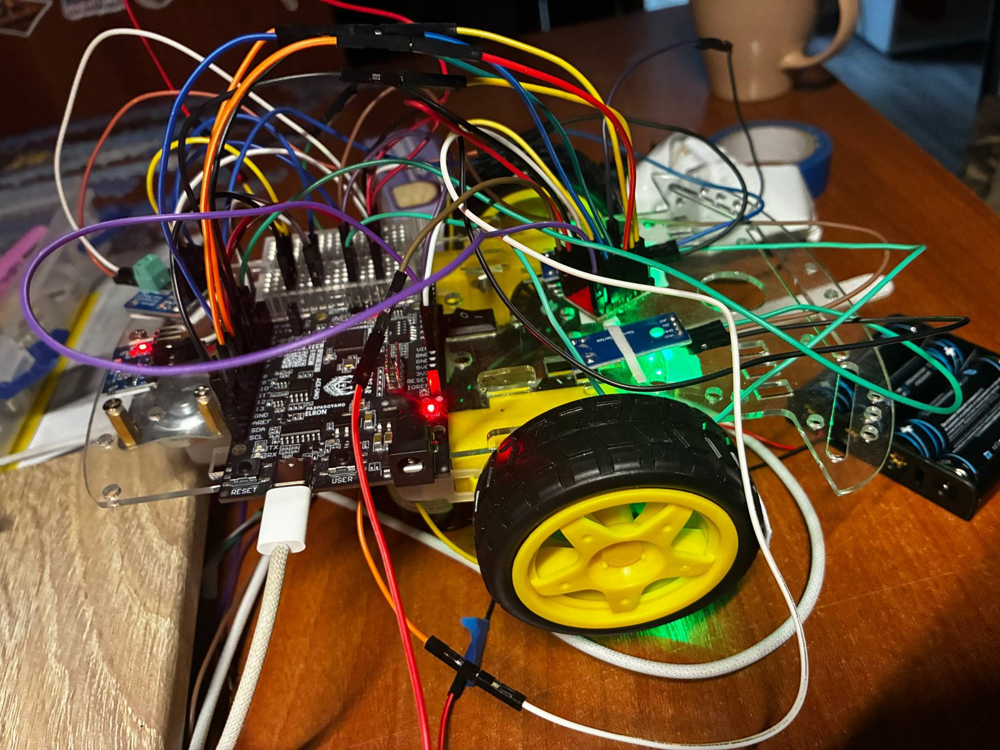
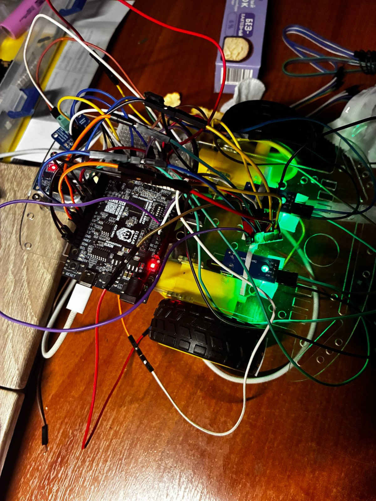
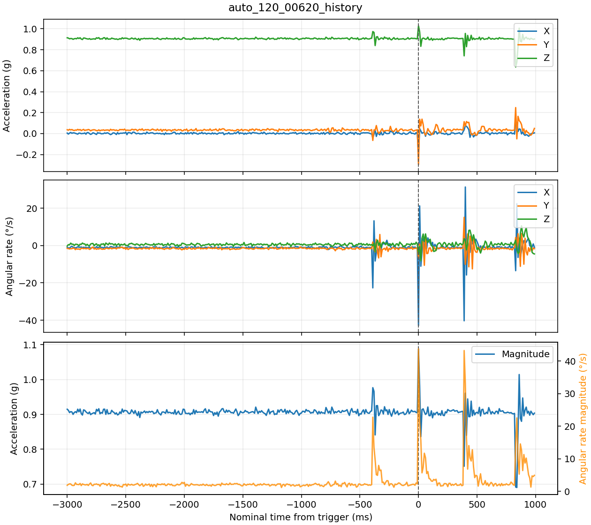
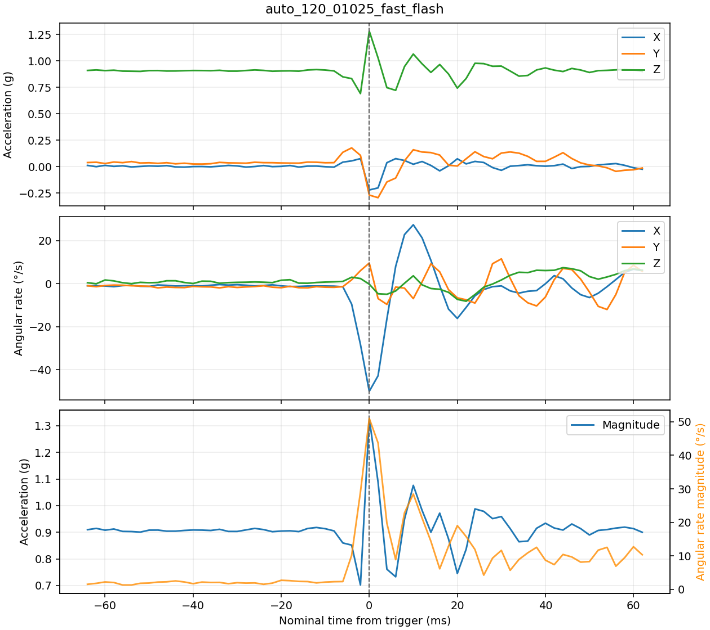
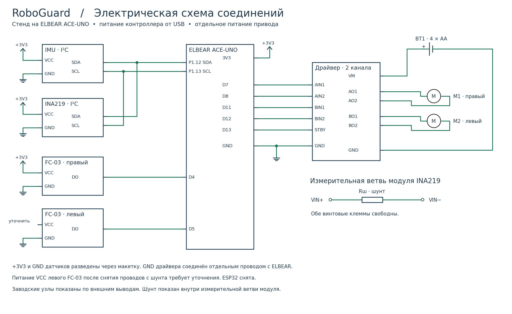

# RoboGuard — независимый чёрный ящик мобильного робота на MIK32 «Амур»

Робот остановился. После перезапуска он снова отвечает на команды, но что произошло за секунду до остановки? Для разбора таких случаев я собрала RoboGuard. У него свой контроллер и свой датчик движения. Когда ускорение превышает заданный порог, RoboGuard сохраняет измерения до и после события. Уже завершённую запись можно прочитать после сброса и построить график на компьютере.

*Двухколёсный испытательный стенд. Регистратор получает питание по USB, привод — от отсека на четыре батареи AA.*

## Что делает MIK32

На шасси установлена ELBEAR ACE-UNO с российским RISC-V микроконтроллером MIK32 «Амур». По I²C он читает ускорение и угловую скорость по трём осям. Аппаратный таймер TIMER32 задаёт номинальный шаг опроса 2 мс, около 500 измерений в секунду. Компьютер нужен для выгрузки результатов. Само событие обнаруживает плата.

В оперативной памяти одновременно ведутся два кольцевых буфера. Длинная история охватывает около четырёх секунд — 400 отсчётов с шагом 10 мс. Быстрое окно содержит 64 отсчёта с шагом 2 мс. По первому графику видно движение шасси перед событием, по второму можно рассмотреть короткий пик, который частично теряется при более редком опросе.

*Монтаж регистратора на шасси. Инерциальный датчик движется вместе с платформой.*

## Как сохраняется событие

Прошивка сравнивает сумму квадратов ускорений по трём осям с квадратом порога. При срабатывании MIK32 сохраняет предысторию, добирает отсчёты после события и записывает оба окна во внешнюю Flash. Вместе с измерениями остаются номер события, причина запуска и положение момента срабатывания в записи.

Код записи во Flash выполняется из оперативной памяти. Прошивка рассчитывает CRC заголовка и данных, а последней операцией ставит метку завершения. После сброса контроллер находит завершённую запись и проверяет её перед выдачей по UART. Если питание пропало во время записи, метка позволяет распознать незавершённый блок.

Для повторного запуска предусмотрено восстановление I²C. Если датчик удерживает линию SDA в низком уровне, MIK32 временно переключает выводы в режим GPIO, подаёт тактовые импульсы на SCL, формирует STOP и заново запускает интерфейс.

## Испытание на шасси

Для проверки автоматического запуска я снизила порог с рабочих **4 g** до **1,20 g**. В опыте № 43 лёгкого толчка оказалось достаточно: в момент срабатывания регистратор измерил **1,32 g**. В журнале сохранился тип события 1 — превышение порога ускорения. Контрольные суммы заголовка и данных прошли проверку.

*Событие № 43. Общая история из Flash, шаг 10 мс. Отметка события на этой шкале приближённая.*

*Тот же опыт в быстром окне. Участок вокруг срабатывания показан с шагом 2 мс.*

Отдельно я проверила чтение после перезапуска. В опыте № 42 запись запускалась вручную. После сброса плата вернула из Flash все 64 отсчёта быстрого окна. Номер отсчёта запуска и пик ускорения **1,394 g** совпали с исходной записью в оперативной памяти.

## Схема и состав стенда

*ELBEAR и датчики питаются от USB через плату и линию 3,3 В. Батарейный отсек подключён к VM драйвера, земля драйвера соединена с ELBEAR.*

На шасси установлены два датчика вращения FC-03. При раздельной проверке приводов зарегистрировано по четыре импульса от каждого колеса. Совместный запуск оказался нестабильным. Контроль тока на INA219 и контроль периодического сигнала от основного контроллера предусмотрены для дальнейшей диагностики. В показанной конфигурации VIN+ и VIN− свободны, ESP32 снята. Подключение VCC левого FC-03 после изменения монтажа требует сверки.

## Где пригодится RoboGuard

Первый сценарий применения — испытания и сервис колёсных платформ. Например, у складской тележки после остановки перезапустился основной контроллер. Инженер подключается к регистратору и проверяет, был ли в этот момент механический удар, как двигалась тележка перед ним и что произошло сразу после. Эти данные помогают выбрать следующий шаг проверки. Для установки на готовую платформу нужны плата регистратора и инерциальный датчик. Шасси и моторы в этом проекте служат испытательным стендом.

## Сколько стоит повторить прототип

Ориентир на 25 ноября 2026 года для покупки по одной штуке. Расчёт по открытым предложениям для сопоставимой комплектации, без доставки, проводов, макетки и батареек.

| Комплектующие | Ориентир |
|---|---:|
| ELBEAR ACE-UNO, вариант с 8 МБ Flash | 3 500 ₽ |
| Инерциальный модуль класса GY-521 | 297 ₽ |
| **Основные компоненты регистратора** | **3 797 ₽** |
| Шасси 2WD с двумя моторами, колёсами, отсеком и драйвером, сопоставимый комплект | 2 150 ₽ |
| INA219 | 128 ₽ |
| Два FC-03 по 271 ₽ | 542 ₽ |
| **Регистратор и основные компоненты испытательного стенда** | **6 617 ₽** |

Для сравнения взят комплект шасси с включённым драйвером, поэтому отдельной строки за драйвер нет. Источники цен: [ELRON](https://elron.tech/russian-arduino-compatible-board/), [инерциальный модуль и INA219](https://www.notshome.ru/?cat=electro), [шасси с приводом](https://www.youbot.ru/product/shassi-tri-kolesa-s-komplektuyuschimi-v-korobke), [FC-03](https://www.propartner.kz/offers/datchik-toka-cjmcu-758-acs758lcb-050b-p).

## Как повторить проверку

В репозитории доступны исходники прошивки на C, конфигурация PlatformIO, программа обработки на Python, схема для EasyEDA Standard и результаты испытаний в CSV. Для сборки регистратора используется профиль `mik32v2`. Путь к загрузчику и номер COM-порта в конфигурации нужно указать для своего компьютера.

После запуска платы открыть терминал на 115200 бод и подождать четыре секунды, пока заполнится история. Команда `c` запускает ручную запись. После сообщения о завершении можно перезагрузить плату и сохранить журнал UART. Команда `python main.py trial.log --label trial --out report` создаст таблицы, графики и сводку измерений.

## Файлы проекта

[Прошивка MIK32](roboguard-fw/src/) · [Скетч ESP32](roboguard-fw/bench/esp32_heartbeat/) · [Анализ записей](main.py) · [Схема EasyEDA](RoboGuard-EasyEDA-Std.json) · [Журналы и графики](roboguard-fw/logs/)

Сборка из каталога roboguard-fw: `pio run -e mik32v2`. Для загрузки в Windows добавьте elbear_uploader.exe в PATH и выберите порт платы в platformio.ini.
